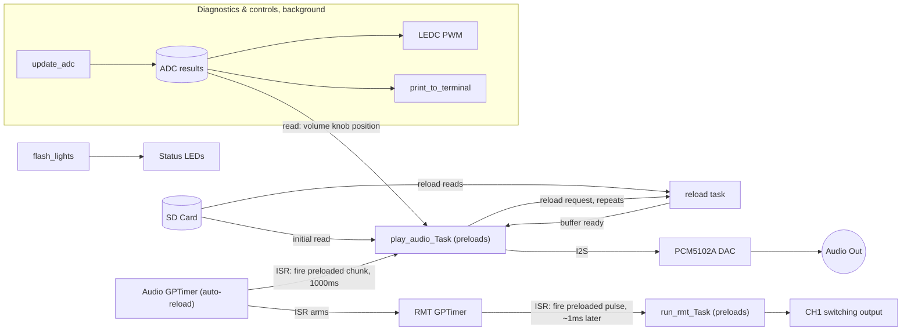
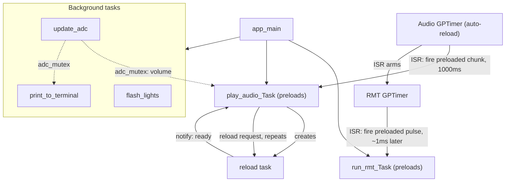
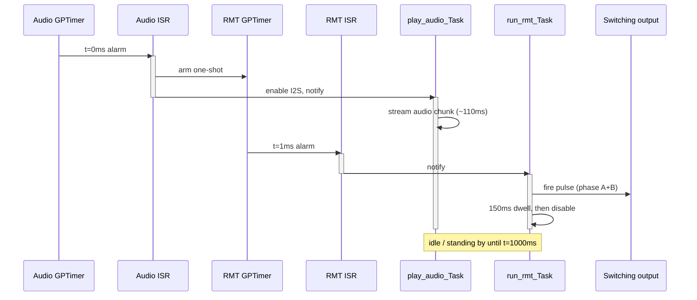

> **A note on authorship:** All of the code here (aside from minor bug fixes) was written by hand by David Earley over the course of 2+ years.  This includes the timing logic, updating of the RMT and I2S drivers, and organization of FreeRTOS tasks and inter-task communication.  Excluding the original driver code in the components folder written by Espressif.  This README, however, was written by Claude.

# signal_timing_pcb — Audio-Synchronized Electrical Output Firmware

Firmware for an ESP32-S3 that plays a 96 kHz/32-bit stereo WAV file over I2S **and** fires precisely-timed electrical switching pulses (via RMT) synchronized with that audio. The audio and the electrical output are are *coordinated to 5-10ms of each other*, using hardware timers and a pair of hand-patched ESP-IDF peripheral drivers to get there.


If you're new to this codebase, read this document top to bottom once — the pieces (GPTimer → ISR → FreeRTOS queue/notification → task) only make sense together.

---

## Table of contents

1. [System overview](#system-overview)
2. [Hardware / pin reference](#hardware--pin-reference)
3. [FreeRTOS task architecture](#freertos-task-architecture)
4. [The audio ⟷ RMT timing handshake](#the-audio--rmt-timing-handshake)
5. [SD card subsystem](#sd-card-subsystem)
6. [Audio pipeline deep dive](#audio-pipeline-deep-dive)
7. [RMT output pipeline deep dive](#rmt-output-pipeline-deep-dive)
8. [Function reference](#function-reference)
9. [Custom ESP-IDF driver patches](#custom-esp-idf-driver-patches)
10. [Known limitations / TODOs](#known-limitations--todos)
11. [Build & flash](#build--flash)

---

## System overview



*(`SD` = SD card holding the WAV file, `RELOAD` = the background reload task that refills the audio buffer — see below, `STATE` = the shared `Adc_Update_Struct`. `(preloads)` / `(auto-reload)` on a node is the point: each cycle, the next chunk/waveform is fully staged ahead of time, then the GPTimer's ISR just **fires** what's already staged — see [the timing handshake](#the-audio--rmt-timing-handshake) for the full play-by-play. `DIAG` is pulled out separately since it's peripheral to the core audio/RMT sync chain — see the sections below for what every arrow actually carries.)*

The board has **two synchronized outputs** driven from the same trigger:

- **Audio** — a WAV file streamed from an SD card, out over I2S to a PCM5102A DAC.
- **Electrical switching output** — a pair of complementary RMT-driven GPIOs (`CH1_SW_OUTA_PIN` / `CH1_SW_OUTB_PIN`) that pulse a fixed waveform shortly after each audio chunk starts.

A dedicated pair of hardware GPTimers is used purely to keep these two outputs in lockstep: one timer paces when a new audio chunk starts (every `AUDIO_PLAY_INTERVAL_MS` = 1000 ms), and a second, much shorter one-shot timer fires ~1 ms later to trigger the RMT pulse — giving the DAC/analog output chain a moment to settle before the electrical switching event happens. See [The audio ⟷ RMT timing handshake](#the-audio--rmt-timing-handshake) for the full mechanism.

Supporting all this: SD card WAV parsing/streaming, a double-buffered chunked audio loader (so playback never stalls waiting on SD card I/O), ADC monitoring of a volume knob and two "channel" knobs plus battery/high-voltage bus sensing, and an LEDC PWM output that turns the channel-1 knob position into a current-setpoint duty cycle.

**Target chip:** ESP32-S3 (`CONFIG_IDF_TARGET="esp32s3"`).

---

## Hardware / pin reference

### SD card (SPI mode)

| Signal | GPIO | Define |
|---|---|---|
| MISO (DO) | 13 | `PIN_NUM_MISO` |
| MOSI (DI) | 11 | `PIN_NUM_MOSI` |
| CLK | 12 | `PIN_NUM_CLK` |
| CS | 10 | `PIN_NUM_CS` |

### I2S (audio out, → PCM5102A)

| Signal | GPIO | Define |
|---|---|---|
| BCK (bit clock) | 6 | `I2S_BCK_PIN` |
| WS / LRCK | 4 | `I2S_WS_PIN` |
| DOUT | 5 | `I2S_DOUT_PIN` |
| XSMT (DAC mute, active high = unmuted) | 7 | `XSMT_PIN` |

Audio format: 96 kHz sample rate, 32-bit stereo, DMA buffered with 8 × 500-sample descriptors (`NUM_DMA_BUFF` / `SIZE_DMA_BUFF`).

### RMT (electrical switching output)

| Signal | GPIO | Define | Notes |
|---|---|---|---|
| CH1 SW_OUT+ | 8 | `CH1_SW_OUTA_PIN` | comment in code notes this *should* be GPIO 9, but GPIO9 is burnt out on this board revision |
| CH1 SW_OUT− | 21 | `CH1_SW_OUTB_PIN` | repurposed the CH-enable pin for this |
| CH2 SW_OUT+ | 36 | `CH2_SW_OUTA_PIN` | defined, **not yet wired into `run_rmt_Task`** |
| CH2 SW_OUT− | 37 | `CH2_SW_OUTB_PIN` | defined, **not yet wired into `run_rmt_Task`** |

### ADC inputs (all `adc_oneshot`, 12-bit, 0–3.3 V attenuation)

| Signal | GPIO | Unit / Channel | Define |
|---|---|---|---|
| Volume knob | 14 | ADC2 / CH3 | `VOL_PIN` |
| CH1 knob | 1 | ADC1 / CH0 (**configured to read CH2's ADC in code — see [Known limitations](#known-limitations--todos)**) | `CH1_KNOB_PIN` |
| CH2 knob | 15 | ADC2 / CH4 | `CH2_KNOB_PIN` |
| Battery sense (9 V rail, resistor divider) | 16 | ADC2 / CH5 | `BATT_PIN` |
| High-voltage bus sense (28 V rail, resistor divider) | 18 | ADC2 / CH7 | `HVDIV_PIN` |

### PWM (LEDC, current setpoint)

| Signal | GPIO | Define |
|---|---|---|
| CH1 current-set PWM | 2 | `CH1_CURSET_PIN` (LEDC timer 0, channel 0, 8-bit, 10 kHz) |
| CH2 current-set PWM | 47 | `CH2_CURSET_PIN` (defined, **no LEDC channel configured for it yet**) |

### Misc GPIO

| Signal | GPIO | Define |
|---|---|---|
| LED 1 | 48 | `LED1_PIN` |
| LED 2 | 38 | `LED2_PIN` |
| Button 1 | 35 | `B1_PIN` (defined, not currently read anywhere) |
| Button 2 | 17 | `B2_PIN` (defined, not currently read anywhere) |

---

## FreeRTOS task architecture

| Task | Priority | Core | Created in | Purpose |
|---|---|---|---|---|
| `flash_lights` | 1 (`BACKGROUND_TASK_PRIORTIY`) | any | `app_main` | Alternately blinks the two status LEDs every 500 ms; also drops `XSMT_PIN` low at boot to keep the DAC muted until audio setup is ready. |
| `update_adc` | 1 | any | `app_main` | Every 100 ms: reads all 5 ADC channels into the shared, mutex-protected `Adc_Update_Struct`, and drives the CH1 current-set PWM duty cycle from the CH1 knob reading. |
| `print_to_terminal` | 1 | any | `app_main` | Every 100 ms: prints a one-line status readout (volume/ch1/ch2 knob %, battery V, HV bus V) to the console. Purely diagnostic. |
| `run_rmt_Task` | 5 (`RMT_TASK_PRIORITY`) | 1 (`RMT_TASK_CORE`) | `app_main` | Owns both RMT TX channels (phase A/B). Pre-encodes the switching waveform into RMT hardware memory ahead of time, then waits for a notification to actually fire it — see [timing handshake](#the-audio--rmt-timing-handshake). |
| `play_audio_Task` | 7 (`AUDIO_TASK_PRIORITY`) | 0 (`AUDIO_TASK_CORE`) | `app_main` | Owns the SD card, the WAV file, the I2S channel, and the two hardware GPTimers that pace playback and the RMT trigger. This is the "conductor" of the whole system. |
| `stp_sd__threadsafe_reload_chunk_memory_buffer_Task` | 7 (`AUDIO_TASK_PRIORITY`) | 0 (`AUDIO_TASK_CORE`) | inside `play_audio_Task` | Runs alongside audio playback; refills the *next* audio buffer from the SD card while the *current* buffer is being streamed out over I2S, so file I/O never blocks the audio output. |



(`app_main` creates every task shown here and then idles — it doesn't participate further. `GPT1`/`GPT2` are the two hardware timers set up *inside* `play_audio_Task`, not separate tasks. `(preloads)` / `(auto-reload)` on a node is the key thing to notice: each cycle, `AUD`/`RMTT` fully stage the next chunk/waveform ahead of time, `GPT1` auto-reloads and fires on its own schedule, and each GPTimer's ISR then just **fires** whatever's already staged — see [the timing handshake](#the-audio--rmt-timing-handshake) below for the full play-by-play. `BG` groups the lower-priority diagnostic tasks off to the side, since they're not part of the critical audio/RMT timing chain. Full detail behind every arrow is in the table below.)

### Inter-task communication summary

| Mechanism | Between | Purpose |
|---|---|---|
| `adc_mutex` (`SemaphoreHandle_t`) + `Adc_Update_Struct` | `update_adc` ↔ `play_audio_Task`, `print_to_terminal` | Guards the shared ADC results struct. `play_audio_Task` uses a **2-tick timeout** (`pdMS_TO_TICKS(2)`) when taking it for volume, so a busy ADC task never stalls audio playback — it just keeps the last known volume. |
| `start_audio_play_queue` (1-deep `QueueHandle_t`) | Audio GPTimer ISR (`start_audio_GPTimer_callback`) → `play_audio_Task` | Signals "the hardware timer fired, the I2S channel has been enable-triggered from the ISR, go finish enabling and play." |
| `reload_audio_buff_Queue` (1-deep, holds a `stp_sd__reload_memory_data_struct`) | `play_audio_Task`/`stp_audio__play_audio_chunk` → reload task | Hands off exactly where in the WAV file, and into which buffer, the next block of samples should be read. |
| `xTaskNotify` (raw FreeRTOS task notification) | reload task → `play_audio_Task` | "I've finished reading the next block from SD, your buffer is ready." Used instead of a queue since it's a single scalar "done" signal and it's the cheapest FreeRTOS IPC primitive available. |
| `xTaskNotifyFromISR` | RMT GPTimer ISR (`start_RMT_output_gptimer_cb`) → `run_rmt_Task` | "It's time — fire the pre-loaded RMT waveform now." |
| `rmt_task_to_notify` (a `TaskHandle_t` carried inside `Audio_Task_Setup_Struct`) | set up once in `app_main`, used by the ISR above | Lets the audio task's own hardware timer ISR directly wake the *separate* RMT task without going through a queue. |
| `program_state_queue` | created in `app_main`, threaded through most structs | **Scaffolding for a state machine (`ProgramStates`: `END`/`AUDIO_VOL_TEST`/`AUDIO_ONLY`/`BIMODAL`/`SETUP`) that isn't fully wired up yet** — see [Known limitations](#known-limitations--todos). Currently only `SETUP` is ever sent. |

---

## The audio ⟷ RMT timing handshake

This is the part that makes the board do what it's designed to do: fire an electrical pulse at a known, fixed offset after an audio chunk begins playing, cycle after cycle, indefinitely.

Two hardware `gptimer` instances are set up inside `play_audio_Task`:

- **Audio GPTimer** — 1 µs resolution, alarm every `AUDIO_PLAY_INTERVAL_MS` (1000 ms), **auto-reload** (it's meant to free-run forever, once per second, for the life of the program).
- **RMT GPTimer** — 1 tick = 10 µs (`resolution_hz = 100000`), alarm after `RMT_PLAY_DELAY_MS` (~1 ms, tunable via `PCM5102A_LATENCY_COMPENSATION_US` to compensate for DAC group delay), **one-shot** (`auto_reload_on_alarm = false`) — it fires exactly once per cycle and is explicitly restarted by the audio timer's ISR.

> **Why one-shot and not auto-reload for the RMT timer?** It was originally auto-reload with a manual `gptimer_stop()` inside its own callback to fake one-shot behavior. That pattern let the hardware counter drift out of sync with when it was actually (re)started each cycle, and produced an extra, spurious RMT firing on top of the intended one — i.e. two electrical pulses per audio chunk instead of one. Switching it to genuine one-shot mode (and letting the audio timer's ISR restart it fresh every cycle) fixed it. The **audio** GPTimer, by contrast, *needs* to stay auto-reload — it's the thing that has to free-run periodically for the life of the program.

### Timeline of one cycle

The key thing to take away: **only about 1–2 ms of each 1000 ms cycle is timing-critical.** Everything else is either streaming audio in the background or sitting idle, pre-armed, waiting for the next trigger. All times below are relative to the Audio GPTimer alarm at `t = 0`, and the whole pattern repeats every `AUDIO_PLAY_INTERVAL_MS` (1000 ms):

| t (ms) | Event |
|---|---|
| 0 | Audio GPTimer alarm fires → RMT GPTimer armed, I2S enabled from ISR, audio chunk starts streaming |
| ~1 | RMT GPTimer (one-shot) fires → RMT pulse (phase A + phase B) fires on the switching output |
| ~110 | Audio chunk finishes streaming; I2S goes idle, next chunk already pre-loaded |
| 151 | RMT dwell (`vTaskDelay(150ms)`) ends → RMT channels disabled, then immediately re-armed and re-preloaded |
| 151 → 1000 | Everything idle / standing by, waiting for the next alarm |
| 1000 | Next Audio GPTimer alarm — cycle repeats |

That long idle tail is exactly what the preload/do-transaction split (RMT) and the enable/finish-enable split (I2S) are optimizing around: the only thing that has to happen at the very last moment, at minimal latency, is the trigger itself — everything expensive has already been done ahead of time.

### Causal sequence within one cycle



The **preload/do-transaction split** in `run_rmt_Task` exists specifically to keep the RMT-side latency in that last hop (ISR → actual GPIO edge) as small and consistent as possible: the expensive part (encoding the waveform symbols into the RMT peripheral's hardware memory) happens *before* the notification arrives, so all that's left to do at trigger time is flip the "go" bit (`rmt_ll_tx_start`). This required patching the ESP-IDF RMT driver — see [Custom ESP-IDF driver patches](#custom-esp-idf-driver-patches).

Likewise, `i2s_channel_enable_from_ISR()` on the I2S side exists so the *hardware* enable can happen directly from the Audio GPTimer's ISR (lowest possible latency between "timer fired" and "I2S clocks are running"), while the FreeRTOS-unsafe bookkeeping (mutex, semaphore, power-management lock) that the stock `i2s_channel_enable()` normally does in one atomic call is deferred to `i2s_channel_finish_enabling_after_ISR()`, run from task context a moment later.

---

## SD card subsystem

This board doesn't generate or embed any audio itself — it's built entirely around **reading a specific, pre-loaded WAV file off of a physical SD card**. There's no fallback tone generator: without a correctly-prepared card, `stp_sd__mount_sd_card` or `stp_sd__open_audio_file` fails, `play_audio_Task` returns immediately, and nothing plays or fires (the RMT trigger is armed from that same task, so it never starts up in the first place). `play_audio_Task` owns the SD card end-to-end.

### Preparing a card

- **FAT-formatted.** The mount call uses `format_if_mount_failed = false`, so an unformatted or corrupted card fails outright rather than being auto-formatted for you.
- **A WAV file at the root of the card**, named to match `AUDIO_FILENAME` in `main.cpp` — currently `/SINEA.wav` (an alternate `/WHITE.wav` is present in a comment but not active).
- That file must be **exactly**: PCM format, **stereo**, **96000 Hz**, **32-bit** samples. `stp_sd__open_audio_file` checks all four and hard-fails if any don't match — there's no resampling or format-conversion path, the file has to already be in this exact format.

### Mount → open → stream

1. **`stp_sd__mount_sd_card`** brings up the SPI bus (`PIN_NUM_MISO`/`MOSI`/`CLK`/`CS`) and mounts the FAT filesystem at `/sdcard`. On failure it waits 1 second and retries **exactly once** before giving up.
2. On success, it prints the card's info and does a debug directory listing of `/sdcard` — a quick way to confirm the right file actually made it onto the card.
3. **`stp_sd__open_audio_file`** opens `AUDIO_FILENAME` and validates the WAV header as described above.
4. From there, the rest of the audio pipeline — chunking, double-buffered reloads, I2S streaming — operates purely on the already-open `FILE*`; see [Audio pipeline deep dive](#audio-pipeline-deep-dive) below.

### Unmounting

**`stp_sd__unmount_sd_card`** unmounts the FAT filesystem *before* freeing the SPI bus — that order matters: freeing the bus while a device (the SD card) is still attached to it fails with a `spi_master` "not all CSses freed" error. In the current code this only runs from the unreachable cleanup path after `play_audio_Task`'s `while(true)` loop (see [Known limitations](#known-limitations--todos)), so in practice the card stays mounted for the life of the program.

---

## Audio pipeline deep dive

### WAV file → chunk → I2S

1. **`stp_sd__open_audio_file`** parses the RIFF/WAVE header and validates the file is PCM, stereo, 96 kHz, 32-bit — anything else is rejected. It records the file byte-offset where audio data starts/ends.
2. **`stp_sd__init_audio_chunk`** computes the layout of one "chunk" — a fixed-size window of audio, padded on both ends with a short **dither** region and a **cosine-ramp** fade, so the PCM5102A DAC doesn't pop when playback starts/stops:

```
     A                    B                       C                         D                       E                    F
     | Start Dither       | Cosine Rise           | Full scale audio output | Cosine Fall           | End Dither         |
     | pre_dither_ms       | rise_fall_ms          |                         | rise_fall_ms          | post_dither_ms     |
     |<------------------------------------------ chunk_len_inc_dither ------------------------------------------------->|
                           |<---------------------- chunk_len_wo_dither -------------------------->|
```
   (`A`…`F` are the index fields `audio_chunk.A_idx`…`F_idx`; `chunk_len_wo_dither_ms` = 100 ms, `rise_fall_ms` = 10 ms, dither = `AUDIO_PRE_POST_DITHER_MS` = 5 ms on each end, in the current config.) A cosine lookup table (`cos_ramp_LUT_ptr`) is precomputed once for the rise/fall regions.
3. **`stp_sd__get_new_audio_chunk`** seeks to a chosen offset in the file (currently always the file's midpoint — `random = 0.5` — the random-seed path exists but `use_random` is hardcoded `false` in `play_audio_Task`) and fills the chunk's primary buffer (`chunk_data_ptr`) directly from the SD card.
4. **`stp_audio__preload_buffer`** pulls samples out of the chunk one at a time via `stp_sd__get_next_audio_sample` (which walks the A→F regions above, applying the cosine ramp/dither as it goes), scales each by the current volume, and hands the result to `i2s_channel_preload_data` — this stages the *first* buffer's worth of samples into the I2S DMA hardware **before** the channel is even enabled, so playback can start with zero warm-up latency the instant the Audio GPTimer fires.
5. **`stp_audio__play_audio_chunk`** does the same sample-by-sample walk for the *rest* of the chunk, writing to the I2S channel in DMA-buffer-sized bursts via `i2s_channel_write`. Whenever the working memory buffer (`chunk_data_ptr`) runs low (`memory_buffer_pos` reaches capacity), it signals the reload task and blocks on `xTaskNotifyWait` until a fresh block has been read in from the SD card into `chunk_load_ptr`, which then gets `memcpy`'d over the working buffer.

### Double buffering (`stp_sd__threadsafe_reload_chunk_memory_buffer_Task`)

This task exists so that SD card reads (slow, blocking, unpredictable latency) never stall the I2S sample loop. It sits in a loop blocked on `xQueueReceive(reload_audio_buff_Queue, ...)`, and whenever `play_audio_Task` (via `stp_audio__preload_buffer` / `stp_audio__play_audio_chunk`) sends it a `stp_sd__reload_memory_data_struct` describing *where* in the file and *how much* to read, it `fseek`s + `fread`s that block into `chunk_load_ptr`, then wakes the audio task back up with `xTaskNotify`. Two single-item queues (`reload_audio_buff_Queue` for requests, task notification for completion) are enough here because there is only ever one outstanding reload request in flight at a time — it's a strict producer/consumer handoff, not a work queue.

---

## RMT output pipeline deep dive

`run_rmt_Task` drives two RMT TX channels — `CH1_SW_OUTA_PIN` ("phase A") and `CH1_SW_OUTB_PIN` ("phase B") — with a hand-authored 6-symbol waveform (`channel1_pha_symbols` / `channel1_phb_symbols`) built directly from `rmt_symbol_word_t` level/duration pairs (not a generic encoder — a `rmt_copy_encoder` is used, which just replays the symbol array as-is).

Each cycle:

1. `rmt_enable()` both channels.
2. `stp__rmt_transmit_preload()` both channels — this **encodes the waveform into RMT hardware memory and arms the interrupts, but stops short of actually starting the TX state machine.** (This is the custom half of the patched driver — see below.)
3. Block on `xTaskNotifyWait` for the RMT GPTimer's ISR to say "now."
4. `stp__rmt_do_transaction()` both channels — flips the RMT peripheral's start bit for real. This is the minimal-latency step that actually puts the waveform on the GPIO pins.
5. `vTaskDelay(150ms)` (fixed dwell so the transmission — a couple of microseconds — has long since finished, plus margin), then `rmt_disable()` both channels and loop back to step 1 to re-arm for the next cycle.

CH2's RMT channels are defined (`CH2_SW_OUTA_PIN` / `CH2_SW_OUTB_PIN`) but **not yet instantiated** in `run_rmt_Task` — this is a planned second channel of electrical output that hasn't been built out yet.

---

## Function reference

### `main.cpp`

| Function | Kind | Purpose |
|---|---|---|
| `flash_lights` | Task | Blink status LEDs; mute DAC at boot. |
| `update_adc` | Task | Poll all ADC channels; drive CH1 current-set PWM. |
| `print_to_terminal` | Task | Diagnostic console readout. |
| `start_audio_GPTimer_callback` | ISR (gptimer alarm) | Arms the RMT one-shot timer, starts I2S from ISR context, wakes `play_audio_Task`. |
| `play_audio_Task` | Task | Owns SD card / WAV file / I2S channel / both GPTimers; main playback loop. |
| `start_RMT_output_gptimer_cb` | ISR (gptimer alarm) | Notifies `run_rmt_Task` that it's time to fire the pre-loaded RMT waveform; stops its own (one-shot) timer. |
| `run_rmt_Task` | Task | Owns both RMT TX channels; preload/trigger/disable cycle described above. |
| `app_main` | Entry point | Creates all shared IPC objects and tasks, then idles (see [Known limitations](#known-limitations--todos) re: the shutdown path). |

### `stp_audio__audio_ops.c` / `.h`

| Function | Purpose |
|---|---|
| `stp_audio__i2s_channel_setup` | Allocates the I2S write buffer, creates and configures the I2S TX channel in standard stereo mode at the configured sample rate/pin set. |
| `stp_i2s__set_vol_scale_factor` | Converts a 0–100% volume knob reading into a linear sample-multiplier, mapped between `MIN_VOL_DBFS`/`MAX_VOL_DBFS`; below `min_vol_percent` the output is fully muted (scale factor 0). |
| `stp_audio__i2s_channel_enable` / `stp_audio__i2s_channel_disable` | Thin wrappers around the stock `i2s_channel_enable`/`disable` (used for the "normal", non-ISR-critical-path enable/disable, e.g. at the end of `play_audio_Task`'s main loop each cycle). |
| `stp_audio__play_audio_chunk` | Streams one full audio chunk to I2S, sample-by-sample, requesting SD reloads as the working buffer drains (see [Audio pipeline](#audio-pipeline-deep-dive)). |
| `stp_audio__preload_buffer` | Stages the first DMA-buffer's worth of a chunk into I2S hardware *before* the channel is enabled, for zero-latency playback start. |

### `stp_adc.c` / `.h`

| Function | Purpose |
|---|---|
| `stp_adc__setup_adc_chans` | Allocates the two ADC oneshot units (ADC1, ADC2) and configures all 5 channels (12-bit, 12 dB attenuation ⇒ full 0–3.3 V range) across them. |
| `stp_adc__read_all_adc_chans` | Reads all 5 channels and converts raw counts into knob percentages / battery & HV bus voltages (using the board's known resistor-divider ratios: ×4.3 for the 9 V rail, ×11 for the 28 V rail). |

### `stp_sd_sdcardops.c` / `.h`

| Function | Purpose |
|---|---|
| `stp_sd__mount_sd_card` / `stp_sd__unmount_sd_card` | SPI bus + FAT filesystem mount/unmount for the SD card. |
| `stp_sd__open_audio_file` / `stp_sd__close_audio_file` | Parse/validate the WAV header; close the file handle. |
| `stp_sd__init_audio_chunk` | Compute chunk region boundaries (A–F above), allocate chunk buffers, precompute the cosine ramp LUT. |
| `stp_sd__get_new_audio_chunk` | Pick a start offset in the file and bulk-read the chunk's primary buffer. |
| `stp_sd__get_next_audio_sample` | Advance one sample through the A→F regions, applying dither/ramp scaling; reports back when the working buffer needs a reload. |
| `stp_sd__threadsafe_reload_chunk_memory_buffer_Task` | Background SD-reload task (see [Double buffering](#double-buffering-stp_sdthreadsafe_reload_chunk_memory_buffer_task)). |
| `stp_sd__free_audio_chunk` | Frees chunk buffers. |

---

## Custom ESP-IDF driver patches

Two ESP-IDF v5.4.2 components have been **vendored into this project** (copied into `components/`, which ESP-IDF's build system resolves *before* falling back to the SDK's built-in copy of the same-named component) and hand-patched. This makes the patches part of the project's own version control and means anyone building this project gets them automatically — no need to modify their own ESP-IDF install.

```
app/components/
├── esp_driver_i2s/    (full vendored copy of $IDF_PATH/components/esp_driver_i2s, patched)
└── esp_driver_rmt/    (full vendored copy of $IDF_PATH/components/esp_driver_rmt, patched)
```

### `esp_driver_i2s` — split channel enable (`i2s_common.c`)

Stock `i2s_channel_enable()` does everything in one call: starts the hardware *and* takes a mutex, acquires a power-management lock, and gives a binary semaphore — none of which are safe to call from an ISR. Since the whole point of this firmware is starting I2S with minimal, ISR-level latency in lockstep with the RMT trigger, the function was split in two:

- **`i2s_channel_enable_from_ISR(handle)`** — IRAM-safe, does only the hardware-critical part: `handle->start(handle)` and marks the channel state running. Called directly from `start_audio_GPTimer_callback` (a gptimer alarm ISR).
- **`i2s_channel_finish_enabling_after_ISR(handle)`** — does the rest (mutex, PM lock, semaphore give) from task context, moments later, in `play_audio_Task`.

Together they're a drop-in replacement for one call to the stock `i2s_channel_enable()`, just split across the ISR/task boundary.

### `esp_driver_rmt` — preload / deferred-trigger split (`rmt_tx.c`)

Added at the bottom of the file (marked with `/*REPLACE: ... */` / `/*END REPLACE*/` comments):

- **`stp__rmt_transmit_preload(...)`** — a copy of the stock `rmt_transmit()` internals, except where the stock function would call `rmt_tx_do_transaction()` (which both encodes the waveform into hardware memory *and* starts the TX state machine), this instead calls the new **`rmt_tx_preload_transaction(...)`**, which does the encoding/interrupt-arming half only and leaves the "go" bit untouched.
- **`stp__rmt_do_transaction(preload_struct)`** — the deferred second half: just flips the TX-start bit for the already-encoded transaction. This is what actually needs to happen at precisely the right instant, so it's kept as small as possible.

A `stp__rmt_preload_struct` is threaded through both calls to carry the channel/HAL/transaction state between the "preload now" and "trigger later" steps, since they can be separated by an arbitrary amount of time (in this firmware, up to `RMT_PLAY_DELAY_MS`).

> **Fixed bug:** the preload struct originally stored **value copies** of the internal `rmt_channel_t`/`rmt_hal_context_t` driver structs, including their `spinlock`. `stp__rmt_do_transaction` then took a critical section on *that copy's* spinlock — which provides no actual mutual exclusion with the real channel object that the rest of the driver (the TX-done ISR, `rmt_disable()`, etc.) locks. It's now fixed to store **pointers** to the real channel/HAL objects instead, so the critical section is real. (There was also a dead, unused, silently-truncated copy of the whole `rmt_tx_channel_t` — including its trailing flexible-array transaction pool — being stored and never read; that's been removed.)

To rebuild against a fresh ESP-IDF and re-apply these patches, diff `app/components/esp_driver_{i2s,rmt}` against a stock checkout of the same IDF version and re-apply by hand, or just keep using the vendored copies as-is (they're self-contained and don't need the global IDF install to be patched at all).

---

## Known limitations / TODOs

Pulled from `TODO` comments and observed behavior in the source — not exhaustive, but worth knowing about before you go looking for a "bug" that's actually a known gap:

- **CH1 knob reads the CH2 ADC channel.** In `update_adc` (`main.cpp`), `ch1_adc_unit`/`ch1_adc_chan` are set to the CH2 ADC unit/channel "to make testing easier," per an inline `TODO`. CH1's own knob input isn't actually read yet.
- **GPIO9 is burnt out** on this board revision; `CH1_SW_OUTB_PIN` uses GPIO21 (the H-bridge channel-enable pin) as a workaround instead.
- **CH2 electrical output isn't implemented.** `CH2_SW_OUTA_PIN`/`CH2_SW_OUTB_PIN` and `CH2_CURSET_PIN` are defined but have no RMT channels or LEDC channel configured.
- **The `ProgramStates` state machine (`END`/`AUDIO_VOL_TEST`/`AUDIO_ONLY`/`BIMODAL`/`SETUP`) is scaffolded but not wired up.** `program_state_queue` is threaded through most task-setup structs and `SETUP` is sent once at boot, but the logic that would react to state changes (e.g. the commented-out block near the end of `app_main`, and the commented-out `xQueuePeek`/`vTaskDelete` block at the end of `run_rmt_Task`'s loop) is not currently active. Tasks run forever once started.
- **`app_main` doesn't really "end."** It idles in two back-to-back `vTaskDelay` loops (~1500 seconds total) and then `return`s — but since every real task was already spawned and runs its own infinite `while(true)` loop, this doesn't stop anything; it looks like leftover scaffolding from an earlier, timed test-run design (the loop counts read like round-number test durations, not a real shutdown timer).
- **Unreachable cleanup code.** Both `play_audio_Task` and `run_rmt_Task` have `while(true) { ... }` main loops with cleanup code (`stp_sd__free_audio_chunk`, `stp_sd__close_audio_file`, `stp_sd__unmount_sd_card`, etc.) physically after the loop — none of it currently runs, since nothing breaks out of the loop. Harmless today, but worth knowing if you're trying to figure out how to cleanly stop a task.
- **`RMT_PLAY_DELAY_MS`'s comment doesn't match its resolution.** The RMT GPTimer is configured with `resolution_hz = 100000` (10 µs/tick) but the inline comment above it says "1 tick equals 1 microsecond" (which would require `1000000`). Worth double-checking against a scope if you're tuning the exact audio→RMT offset.
- **Declared-but-unimplemented functions:** `stp_audio__i2s_channel_ISR_enable`/`_finish` (declared in `stp_audio__audio_ops.h`, never defined — superseded by calling the vendored driver's `i2s_channel_enable_from_ISR`/`finish_enabling_after_ISR` directly) and `stp_adc__read_vol_adc_chan` (declared in `stp_adc.h`, never defined).
- **Buttons `B1_PIN`/`B2_PIN` are defined but never configured or read.**

---

## Build & flash

Standard ESP-IDF project layout — this is *not* the stock ESP-IDF SD-card example anymore (an earlier version of this README was, if you're seeing an old cached copy).

```sh
idf.py set-target esp32s3      # first time only
idf.py -p PORT flash monitor
```

The vendored `esp_driver_i2s`/`esp_driver_rmt` components are picked up automatically from `app/components/` — no extra configuration needed, since the top-level `CMakeLists.txt` restricts the build to the `main` component and its dependency tree, and ESP-IDF resolves same-named components from the project's own `components/` directory before falling back to the SDK.

If you ever see driver behavior that doesn't match the descriptions above (e.g. after an IDF upgrade), check `app/components/esp_driver_*` first — it's very possible the vendored copy has drifted from what's described here, or from stock IDF.
